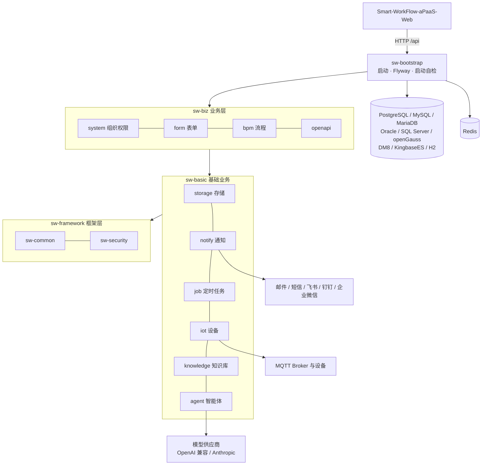

# Smart-WorkFlow-aPaaS-server


Smart-WorkFlow-aPaaS-server 是 **CH-aPaaS** 的后端 API 服务（Java 21 / Spring Boot 3.4），承载组织权限、表单、流程、审批、通知、设备与智能能力的模块化单体。CH-aPaaS 是用于搭建企业业务应用的平台；办公审批（OA）是已经落地的一类使用场景，而不是项目的全部定义。


配套前端：[Smart-WorkFlow-aPaaS-Web](https://github.com/Chikaaho/Smart-WorkFlow-aPaaS-Web)（当前 **0.3.6**）

## 核心特性

| 特性 | 说明 |
| --- | --- |
| 低代码表单引擎 | 可视化设计、发布与版本化定义，子表、表单引用、动态宽表，草稿保存与恢复 |
| 流程引擎 | 基于 Flowable BPMN：会签、条件分支、动态并行、模板中心、监控干预、批量审批与流程交接 |
| 审批意见驱动流转 | 意见表单字段写入流程变量，会签意见按类型聚合，条件分支与参与人直接取用意见 |
| Agent 图编排 | 模型供应商与模型管理、图编排执行（异步受理、持久回查、取消与重启恢复、三协议流式）、内部/外部工具 |
| 知识库与 RAG | 文档分片与检索，向量存储基于 pgvector（非 PostgreSQL 库见多数据库说明） |
| IoT 接入 | MQTT 设备连接、事件规则启动已发布 Agent 图研判，失败自动升级通知负责人 |
| 渠道通知 | 站内信、邮件、短信、飞书、钉钉、企业微信六类渠道共用一套投递权威，模板版本化、失败可重发 |
| 组织与权限 | 多租户列级隔离、用户/部门/角色/菜单、数据范围，企业微信/飞书/钉钉 SSO |
| 多数据库 | 同一套迁移与 SQL 种子覆盖九种数据库（见下文矩阵） |

## 三个示例流程（已完成）

三条示例流程在 UAT 用真实业务数据跑通了「表单 → 流程 → 审批 → 业务动作 → Agent/IoT 联动」的完整链路：

| A · 应急演练 | B · 值班协同 | C · MES 异常研判 |
| --- | --- | --- |
|  |  |  |

- **A · 多部门灾备演练**：跨部门会签与并行审批通过后，按表单预定时间由定时任务登记预约，到点向 MQTT 下发机房断电、火警告警等演练指令。
- **B · 校园出入口流量异常**：Agent 检索校内活动与知识库、结合公开信息研判原因，有解释建 P1 工单、无解释建 P0 工单并经站内信与邮件告警负责人，安保复核后分流督办/上报/现场处置。
- **C · MES 温度智能判断**：Agent 按业务知识研判温度序列（75/80/85℃ 阈值与升温速率），快速升温建工单、超 85℃ 进入紧急停机流程，工单经班组长确认、原因分类后走校准/维修/工艺调整与复产审批。

交付登记与验收链路见工作区 [`knowledge/features/0.3.2-opinion-display.md`](https://github.com/Chikaaho/Smart-WorkFlow-Agent-Workspace/blob/develop-sw/knowledge/features/0.3.2-opinion-display.md)。

## 架构



依赖只能自上而下：`sw-biz` 模块之间只依赖对方的 `-api`；跨模块无返回值交互走 Spring 事件，有返回值走 Facade。详见[工程宪法](docs/governance/engineering-constitution.md)。

## 多数据库支持（0.4.0）

0.4.0 起，同一套迁移脚本与 SQL 种子可在以下数据库上完成空库启动、迁移、种子初始化和业务冒烟：

| 数据库 | 版本 | 验证方式 | 建库前提（摘要） |
| --- | --- | --- | --- |
| H2 | 测试/开发模式 | 既有回归 | 保持现状 |
| PostgreSQL | 14.24（UAT）/ 17.5+（CI） | 实测 | UTF8；UAT 迁移校验和为准；知识库需 pgvector 扩展 |
| MySQL | 5.7 / 8.0 | 实测 | `utf8mb4` + `utf8mb4_bin`；`explicit_defaults_for_timestamp=ON` |
| MariaDB | 10.6+ | 实测 | `utf8mb4_bin`；`explicit_defaults_for_timestamp=ON` |
| Oracle | 21c XE | 实测 | `AL32UTF8`；空串=NULL 语义 |
| SQL Server | 2019+ / 2022 | 实测 | `Chinese_PRC_CS_AS`；终态基线 |
| openGauss | 5.0 | 实测 | `UTF8` + `DBCOMPATIBILITY 'PG'` |
| DM8 | — | Owner 实库验证 | `CASE_SENSITIVE=Y`、`LENGTH_IN_CHAR=1` |
| KingbaseES | V8 | Owner 实库验证 | `database_mode=pg`（参数名随版本） |

完整建库参数、JDBC 示例、向量存储与 SQL Server 基线说明见 [`docs/deployment/multi-database.md`](docs/deployment/multi-database.md)。

## 快速开始

### 环境要求

| 组件 | 版本 | 说明 |
| --- | --- | --- |
| JDK | 21 | 构建与运行 |
| Maven | 3.9+ | 构建 |
| 数据库 | 九选一 | 推荐 PostgreSQL 14+；知识库向量存储需要 pgvector 扩展（推荐 `pgvector/pgvector` 镜像） |
| Redis | 6+ | 登录挑战链与运行状态必需 |

### 1. 克隆与构建

```bash
git clone https://github.com/Chikaaho/Smart-WorkFlow-aPaaS-server.git
cd Smart-WorkFlow-aPaaS-server
MAVEN_OPTS="-Xmx2g" mvn -DskipTests package
# 产物：sw-bootstrap/target/bootstrap.jar
```

### 2. 准备数据库与 Redis

以 PostgreSQL + Docker 为例（生产部署与其他八种数据库的建库前提见[多数据库部署说明](docs/deployment/multi-database.md)）：

```bash
docker run -d --name sw-pg \
  -e POSTGRES_PASSWORD=你的数据库口令 -e POSTGRES_DB=smart_workflow \
  -p 5432:5432 pgvector/pgvector:pg17
docker run -d --name sw-redis -p 6379:6379 redis:7
```

首次启动时 Flyway 自动建表并写入种子数据（约 1—3 分钟），不需要手工执行脚本。

### 3. 本地配置

新建 `sw-bootstrap/src/main/resources/application-local.yml`（`.gitignore` 已忽略该文件，不会被误提交）：

```yaml
spring:
  autoconfigure:
    exclude:
      # 应用自管向量存储（Embedding 由 LangChain4j 按模型配置运行时装配），
      # 与 prod profile 一致，排除 Spring AI 的 pgvector 自动配置
      - org.springframework.ai.vectorstore.pgvector.autoconfigure.PgVectorStoreAutoConfiguration
  ai:
    openai:
      # Spring AI 自动配置要求非空占位；本地开发不需要真实 key
      api-key: sk-your-openai-api-key
  datasource:
    dynamic:
      datasource:
        master:
          url: jdbc:postgresql://127.0.0.1:5432/smart_workflow
          username: postgres
          password: 你的数据库口令
  data:
    redis:
      host: 127.0.0.1
      port: 6379

sw:
  form:
    enabled: true    # 表单与流程业务开关（prod profile 默认开启，local 需显式带上）
  bpm:
    enabled: true
  storage:
    active-provider: local   # 附件存本地 ./uploads；接 MinIO 等对象存储再切换
  # iot:
  #   enabled: true          # 可选：本地 MQTT 联调时开启并配置 broker
```

再生成本地开发密钥（仅开发用；生产必须经密钥设施注入，见[运维手册](https://github.com/Chikaaho/Smart-WorkFlow-Agent-Workspace/blob/develop-sw/docs/ops/production-ops.md)）：

```bash
openssl genpkey -algorithm RSA -pkeyopt rsa_keygen_bits:2048   # 登录口令 RSA 私钥（PKCS#8 PEM）
openssl rand -base64 32    # SW_CIPHER_KEY、SW_SSO_CIPHER_KEY（各自独立生成一份）
openssl rand -base64 24    # SW_LOGIN_DIGEST_SECRET
openssl rand -base64 32    # JWT_SECRET
```

### 4. 启动与健康检查

```bash
SW_LOGIN_RSA_PRIVATE_KEY="$(cat dev-login.key)" \
SW_LOGIN_DIGEST_SECRET="上一步生成" \
SW_CIPHER_KEY="上一步生成" \
SW_SSO_CIPHER_KEY="上一步生成" \
JWT_SECRET="上一步生成" \
SPRING_PROFILES_ACTIVE=local \
java -jar sw-bootstrap/target/bootstrap.jar
```

- 默认端口 `8080`、上下文路径 `/api`；健康检查 `http://127.0.0.1:8080/api/actuator/health` 返回 `{"status":"UP"}`。
- 端口被占用时在 `application-local.yml` 加 `server.port: 18080` 覆盖。
- 生产部署（systemd、日志轮转、备份与升级）见[运维手册](https://github.com/Chikaaho/Smart-WorkFlow-Agent-Workspace/blob/develop-sw/docs/ops/production-ops.md)。

### 5. 首次登录

Flyway 种子内置默认超管：**用户名 `admin`，口令 `AdminP@ssw0rd`**（开发种子口径，见迁移脚本 `R__0.1.10_admin_password.sql`；登录后请立即修改）。界面操作与前端启动见配套前端 [Smart-WorkFlow-aPaaS-Web](https://github.com/Chikaaho/Smart-WorkFlow-aPaaS-Web) 的 README。

## 仓库结构与文档导航

| 路径 | 说明 |
| --- | --- |
| `sw-dependencies` | BOM，统一依赖版本 |
| `sw-framework` | `sw-common`、`sw-security` 框架层 |
| `sw-basic` | storage / notify / job / iot / knowledge / agent 基础业务 |
| `sw-biz` | system / form / bpm（api/engine/process）/ openapi 业务层 |
| `sw-bootstrap` | 启动模块：装配、Flyway 迁移、启动自检 |
| [工程宪法](docs/governance/engineering-constitution.md) | 模块依赖方向、编码规范与验证门 |
| [多数据库部署说明](docs/deployment/multi-database.md) | 九种数据库的建库前提、JDBC 示例与差异说明 |
| [运维手册](https://github.com/Chikaaho/Smart-WorkFlow-Agent-Workspace/blob/develop-sw/docs/ops/production-ops.md) | 生产部署、升级、备份与回退（工作区仓库） |
| [功能清单](%E5%8A%9F%E8%83%BD%E6%B8%85%E5%8D%95.md) | 正式功能与版本焦点 |

## 当前版本：0.4.0

0.4.0 让同一套迁移脚本和 SQL 种子可以在九种数据库上完成空库启动、迁移、种子初始化和业务冒烟；业务功能与 0.3.2 相同。

| 项目 | 内容 |
| --- | --- |
| tag | `0.4.0` → `a4f6c278`（annotated tag） |
| Release | [CH-aPaaS Server 0.4.0](https://github.com/Chikaaho/Smart-WorkFlow-aPaaS-server/releases/tag/0.4.0)（id `438918154`） |
| 制品 | `bootstrap-0.4.0.jar`，236,245,457 B，sha256 `188be963796af0583f2e59653cfc19cd482856e6fc4d0ecd22f102223b5e620b` |
| 数据库迁移 | Flyway 终点 **V0.4.0**：新增 `V0.4.0__knowledge_vector_persistence.sql` 与 `R__0.4.0_rename_bpm_opinion_comment.sql`；已发布迁移的校验和不变 |
| 部署 | UAT 运行 `build.version=0.4.0`，health UP |

**升级要点**：停服前备份数据库（PostgreSQL 用 `pg_dump -Fc`）并保留旧 jar；换 jar 启动后 Flyway 自动补齐迁移；启动时 `DatabaseCompatibilityGuard` 先检查库级前提（字符集、排序规则、兼容模式），不满足就在迁移前停止。

**回退到 0.3.2 必须先恢复升级前的数据库备份**（只换 jar 会因 Flyway 校验失败无法启动）：停服 → 恢复备份（UAT 为 `smart_workflow_20261109_pre040.dump`）→ 换回 0.3.2 jar → 启动。完整步骤见运维手册 §8.1、§9.1。

### 历史版本

| 版本线 | 内容 |
| --- | --- |
| 0.4.0 | 多数据库兼容：九库迁移与种子（见上） |
| 0.3.0—0.3.2 | 三个示例流程、审批意见驱动流转与意见展示返修（0.3.0 曾被 Owner 审核退回，由 0.3.1—0.3.2 返修） |
| 0.2.0—0.2.4 | AI Agent 能力系列：模型接入、图编排、知识库 RAG、执行生命周期、IoT 事件规则联动 |

各版本 tag、Release 与发布说明见仓库 [tags](https://github.com/Chikaaho/Smart-WorkFlow-aPaaS-server/tags) 与工作区 [CHANGELOG.md](https://github.com/Chikaaho/Smart-WorkFlow-Agent-Workspace/blob/develop-sw/CHANGELOG.md)。

## 许可证与致谢

本仓库为 CH-aPaaS 示例实例的一部分，当前未附带开源许可证；对外使用、分发或再发布前请先与 Owner 确认。

项目基于 Java 21、Spring Boot、Flowable、MyBatis-Plus、Flyway、LangChain4j 等开源组件构建，数据库驱动遵循各自许可证。感谢所有上游项目与贡献者。
