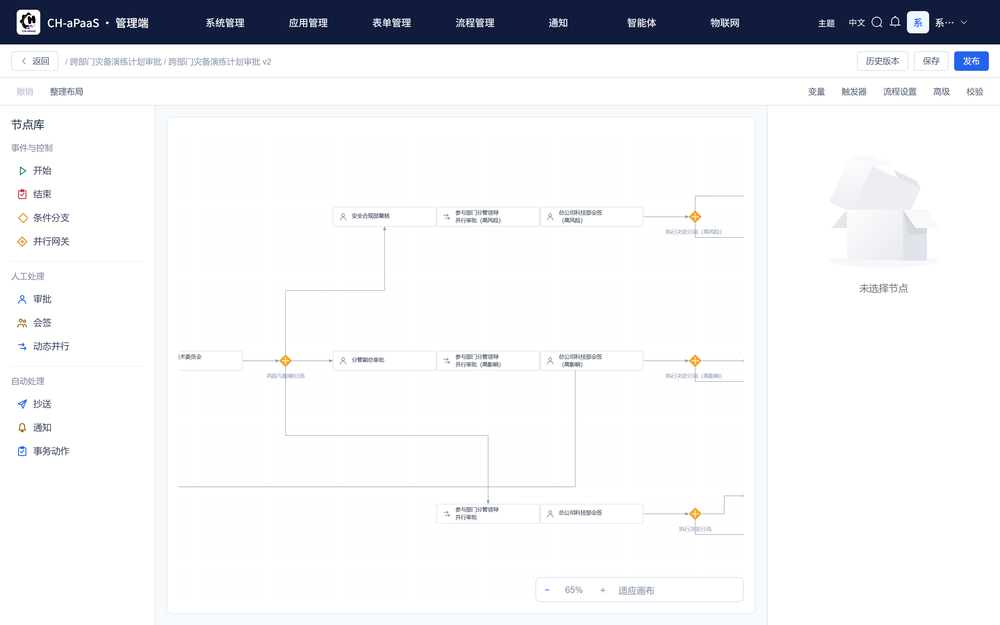
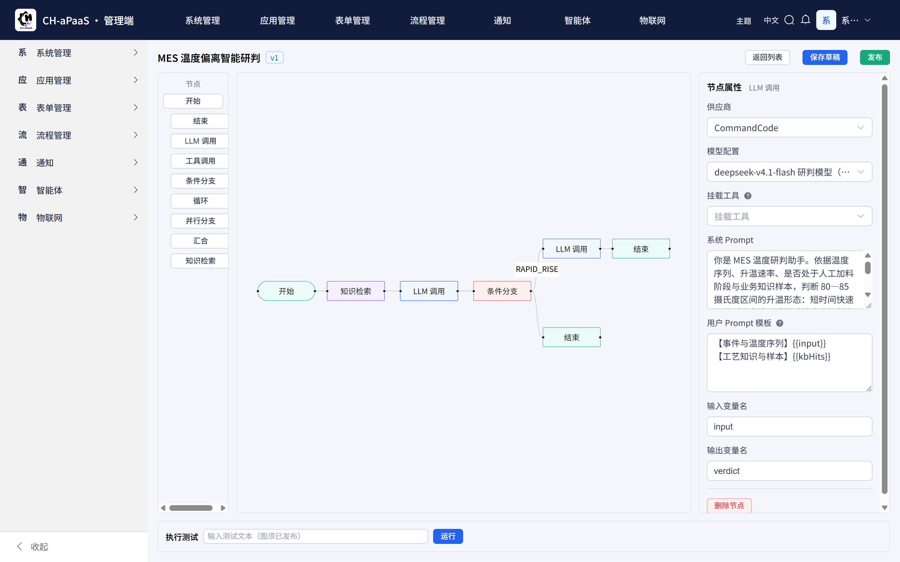
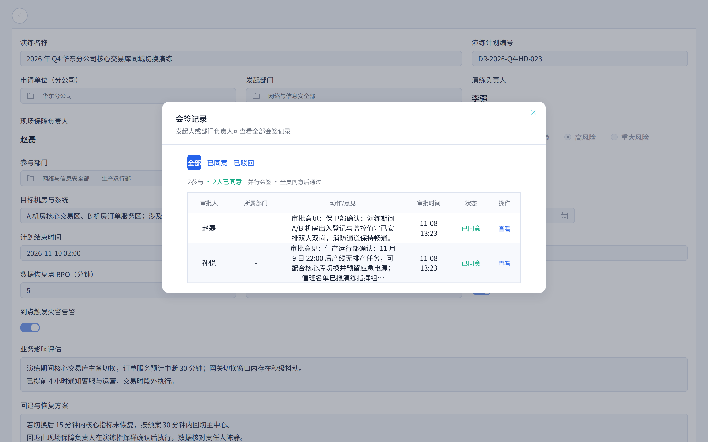
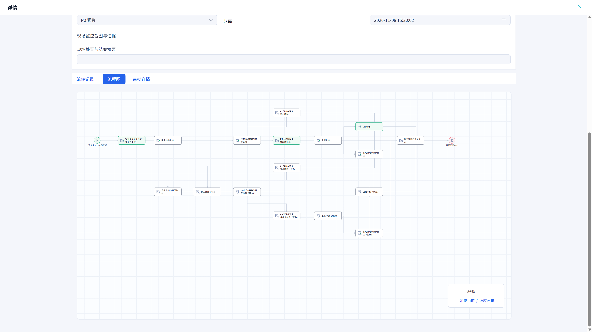
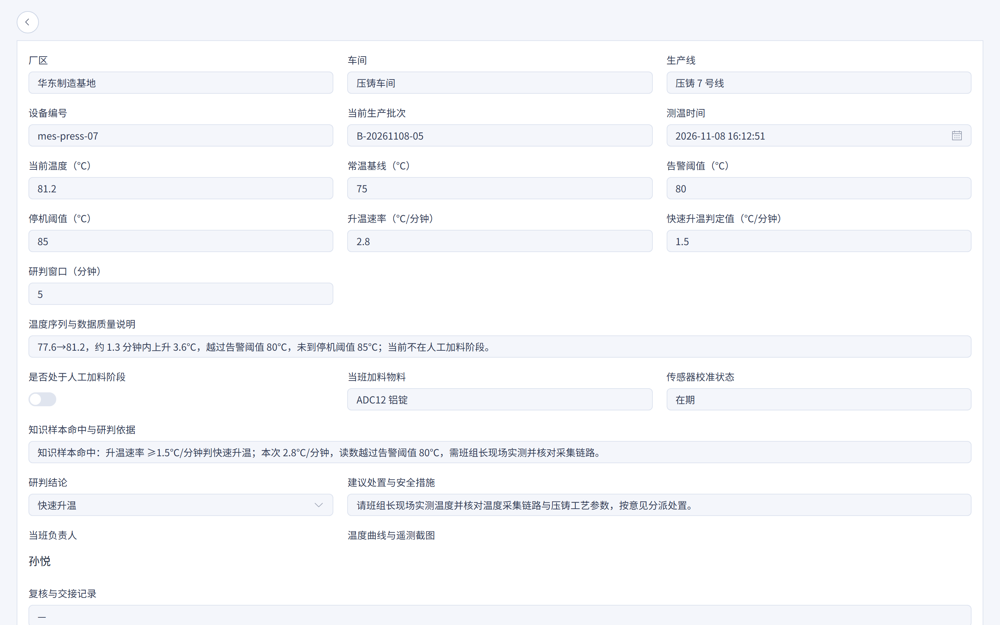
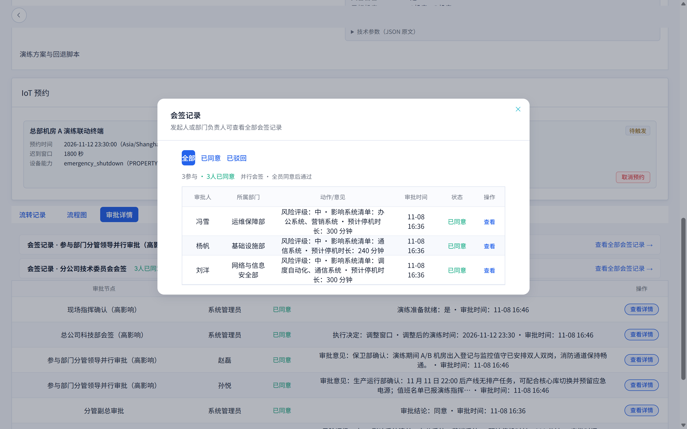
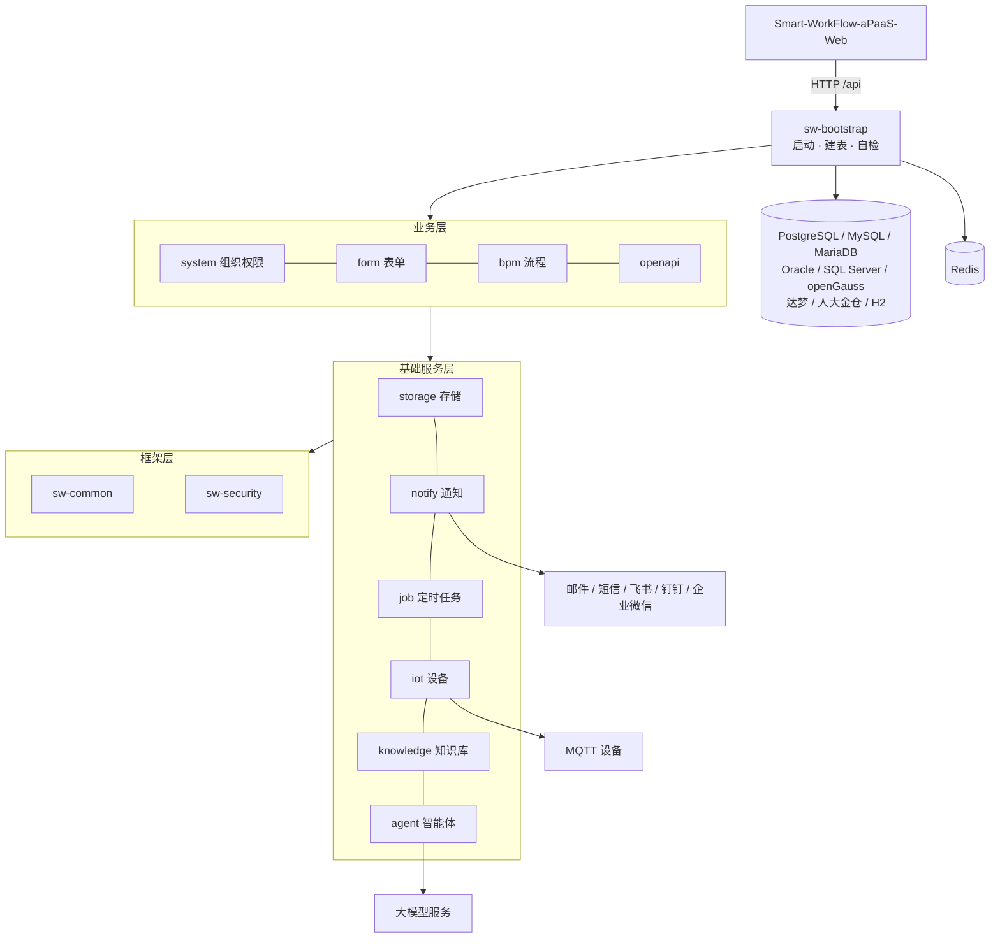

# Smart-WorkFlow-aPaaS-server


Smart-WorkFlow-aPaaS-server 是 **CH-aPaaS** 的后端服务（Java 21 / Spring Boot 3.4）。CH-aPaaS 是一个可以自己搭建业务应用的低代码平台：把业务做成表单和流程，就能在工作台上发起、审批和跟进；在这个基础上，还带 AI 智能体、设备接入和消息通知。






配套前端：[Smart-WorkFlow-aPaaS-Web](https://github.com/Chikaaho/Smart-WorkFlow-aPaaS-Web)（当前 0.3.8，本服务 0.4.1）

## 能做什么

- **表单**：拖拽设计表单，支持附件、图片、子表、默认值和显示联动；填报后自动发起审批。
- **流程审批**：会签、条件分支、多人并行审批，审批意见可以决定流程的走向和下一步办理人。
- **AI 智能体**：图形化编排智能体，接入主流大模型，能调用工具、查知识库回答问题，也能自己发起审批和工单。
- **设备接入**：通过 MQTT 控制设备；设备事件可以触发智能体研判，按结果自动建单和告警。
- **消息通知**：站内信、邮件、短信、飞书、钉钉、企业微信统一发送，失败可重发。
- **组织权限**：部门、角色、数据权限，支持企业微信、飞书、钉钉单点登录。
- **九种数据库**：同一套安装程序可以跑在 PostgreSQL、MySQL、MariaDB、Oracle、SQL Server、openGauss、达梦、人大金仓上（另含测试用 H2）。

## 三个示例流程

三个完整的示例业务，全部可以在演示环境里走通「填表 → 审批 → 自动执行」的全过程：

| 应急演练 | 校园门岗异常 | 设备温度监控 |
| --- | --- | --- |
|  |  |  |

| 会签记录（意见摘要与部门） |
| --- |
|  |

- **应急演练**：一份跨部门演练计划，经过多轮会签和并行审批后，到点自动向机房设备下发断电、告警等演练指令。
- **校园门岗异常**：门岗出现异常人流时，AI 先查校内活动和知识库判断原因：能解释的记录在案并派工单，解释不了的升级为紧急工单并通知负责人。
- **设备温度监控**：AI 按业务设定的温度阈值和升温速度判断设备状态：异常升温自动建单维修，临界停机线时直接触发紧急停机审批。

## 架构



模块名与依赖关系的完整说明见[工程宪法](docs/governance/engineering-constitution.md)。

## 支持的数据库

| 数据库 | 版本 | 建库要求 |
| --- | --- | --- |
| PostgreSQL | 14+ | UTF8；知识库功能需要 pgvector 扩展 |
| MySQL | 5.7 / 8.0 | `utf8mb4` + `utf8mb4_bin`；`explicit_defaults_for_timestamp=ON` |
| MariaDB | 10.6+ | `utf8mb4` + `utf8mb4_bin`；`explicit_defaults_for_timestamp=ON` |
| Oracle | 21c | `AL32UTF8` |
| SQL Server | 2019+ | 排序规则 `Chinese_PRC_CS_AS` |
| openGauss | 5.0 | `UTF8` + `DBCOMPATIBILITY 'PG'` |
| 达梦 DM8 | 8 | `CASE_SENSITIVE=Y`、`LENGTH_IN_CHAR=1` |
| 人大金仓 KingbaseES | V8 | 兼容模式 `pg`（参数名随版本） |

> PostgreSQL、MySQL、MariaDB、Oracle、SQL Server、openGauss 已测试；达梦、人大金仓未测试（欢迎反馈）。

各库的完整建库参数和连接示例见 [多数据库部署说明](docs/deployment/multi-database.md)。

## 快速开始

### 环境要求

| 组件 | 版本 |
| --- | --- |
| JDK | 21 |
| Maven | 3.9+ |
| 数据库 | 上表九选一 |
| Redis | 6+ |

### 1. 克隆与构建

```bash
git clone https://github.com/Chikaaho/Smart-WorkFlow-aPaaS-server.git
cd Smart-WorkFlow-aPaaS-server
MAVEN_OPTS="-Xmx2g" mvn -DskipTests package
# 产物：sw-bootstrap/target/bootstrap.jar
```

### 2. 准备数据库与 Redis

以 PostgreSQL + Docker 为例：

```bash
docker run -d --name sw-pg \
  -e POSTGRES_PASSWORD=你的数据库口令 -e POSTGRES_DB=smart_workflow \
  -p 5432:5432 pgvector/pgvector:pg17
docker run -d --name sw-redis -p 6379:6379 redis:7
```

首次启动会自动建表并写入初始数据（约 1—3 分钟），不需要手工执行脚本。

### 3. 本地配置

新建 `sw-bootstrap/src/main/resources/application-local.yml`（已被忽略，不会误提交）：

```yaml
spring:
  autoconfigure:
    exclude:
      # 排除 Spring AI 的自动向量存储，改由应用自行管理
      - org.springframework.ai.vectorstore.pgvector.autoconfigure.PgVectorStoreAutoConfiguration
  ai:
    openai:
      api-key: sk-your-openai-api-key
  datasource:
    dynamic:
      datasource:
        master:
          url: jdbc:postgresql://127.0.0.1:5432/smart_workflow
          username: postgres
          password: 你的数据库口令
  data:
    redis:
      host: 127.0.0.1
      port: 6379

sw:
  form:
    enabled: true
  bpm:
    enabled: true
  storage:
    active-provider: local
```

再生成几个本地开发用的随机密钥：

```bash
openssl genpkey -algorithm RSA -pkeyopt rsa_keygen_bits:2048   # 登录口令加密私钥（PKCS#8 PEM）
openssl rand -base64 32    # SW_CIPHER_KEY、SW_SSO_CIPHER_KEY（各生成一份）
openssl rand -base64 24    # SW_LOGIN_DIGEST_SECRET
openssl rand -base64 32    # JWT_SECRET
```

### 4. 启动

```bash
SW_LOGIN_RSA_PRIVATE_KEY="$(cat dev-login.key)" \
SW_LOGIN_DIGEST_SECRET="上一步生成" \
SW_CIPHER_KEY="上一步生成" \
SW_SSO_CIPHER_KEY="上一步生成" \
JWT_SECRET="上一步生成" \
SPRING_PROFILES_ACTIVE=local \
java -jar sw-bootstrap/target/bootstrap.jar
```

- 默认地址 `http://127.0.0.1:8080`，健康检查 `http://127.0.0.1:8080/api/actuator/health` 返回 `{"status":"UP"}`。
- 端口被占用时在 `application-local.yml` 加 `server.port: 18080`。
- 生产部署、备份与升级见[运维手册](https://github.com/Chikaaho/Smart-WorkFlow-Agent-Workspace/blob/develop-sw/docs/ops/production-ops.md)。

### 5. 首次登录

- 用户名：`admin`
- 口令：`AdminP@ssw0rd`（登录后请修改）

界面操作见前端仓库 [Smart-WorkFlow-aPaaS-Web](https://github.com/Chikaaho/Smart-WorkFlow-aPaaS-Web)。

## 版本与升级

当前版本 **0.4.1**，与前端 0.3.8 搭配使用。升级时替换 jar 后启动即可，建表脚本会自动补齐；**降级回旧版本前必须先恢复升级前的数据库备份**，否则无法启动。完整步骤见[运维手册](https://github.com/Chikaaho/Smart-WorkFlow-Agent-Workspace/blob/develop-sw/docs/ops/production-ops.md)。

历史版本和下载见 [Releases](https://github.com/Chikaaho/Smart-WorkFlow-aPaaS-server/releases) 与 [CHANGELOG](https://github.com/Chikaaho/Smart-WorkFlow-Agent-Workspace/blob/develop-sw/CHANGELOG.md)。

## 文档

| 文档 | 说明 |
| --- | --- |
| [工程宪法](docs/governance/engineering-constitution.md) | 模块划分、编码规范与开发流程 |
| [多数据库部署说明](docs/deployment/multi-database.md) | 九种数据库的建库参数与连接示例 |
| [运维手册](https://github.com/Chikaaho/Smart-WorkFlow-Agent-Workspace/blob/develop-sw/docs/ops/production-ops.md) | 生产部署、备份、升级与降级 |
| [前端仓库](https://github.com/Chikaaho/Smart-WorkFlow-aPaaS-Web) | 界面与操作说明 |

## 许可证与致谢

本项目以 [MIT License](LICENSE) 开源，可自由使用、修改和分发。

基于 Java 21、Spring Boot、Flowable、MyBatis-Plus、Flyway、LangChain4j 等开源组件构建，感谢这些上游项目与贡献者。
